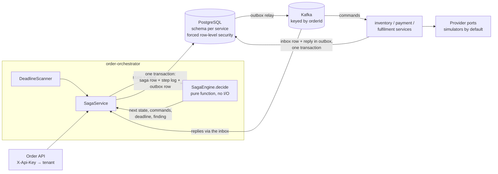

# OrderLoop

OrderLoop is an open-source Shopify app that finds money stuck in orders, in any currency, and helps close each case. It follows every order from checkout to settled money as a saga with deadlines. When an order stalls, it opens an exception showing the amount at risk.

It is a multi-tenant system of five Spring Boot services on PostgreSQL and Kafka. Payment and shipping providers sit behind interfaces whose default adapters are simulators, so the whole system runs on your machine with **no accounts or API keys**.

**Status:** milestone M1, the reliable core, is complete: saga, outbox and inbox, tenancy, deadlines, telemetry, a chaos suite and the one-command demo. The merchant dashboard, Shopify and Stripe come in later milestones (`docs/ROADMAP.md`). Licensed under Apache-2.0 (`LICENSE`; the reasoning is in `docs/adr/0008-apache-2-licence.md`).

## The problem

Between checkout and money in the bank, an order passes through a payment provider and a carrier. Each one can leave money stuck without anyone noticing:

| Leak | What happened |
|---|---|
| Paid, not fulfilled | The customer paid, but nothing shipped |
| NDR past SLA | Delivery failed and nobody decided what to do next |
| RTO not restocked | A returned parcel came back, but its stock was never put on sale again |
| COD remittance gap | Cash on delivery was collected, but the carrier never paid it out |
| Stuck order | Any step that took longer than it should |

Merchants with cash on delivery and high return rates lose the most. OrderLoop reports each leak in the order's own currency, never adding up different currencies, and a human approves every refund.

## How it works



- **The saga is a pure function.** `SagaEngine.decide(state, input, now)` returns the next state, the commands to send, the deadline in force and any finding. It does no I/O, so every transition is covered by table-driven tests. `SagaService` applies the result in one transaction, with optimistic locking, so two replies for one order can never both act on the same state. Only the orchestrator decides what happens next; the other services never call each other. The states and steps are in `docs/SAGA.md`.
- **Outbox and inbox.** A state change and the messages it sends commit together in an `outbox` table, and one relay per service publishes them to Kafka. Each consumer records the event ID in `processed_event` in the same transaction as its own changes, so a redelivered message does nothing. Kafka delivers at least once, and the database state comes out as if each message were handled exactly once, without distributed transactions.
- **Tenancy is enforced by the database.** The tenant comes from a verified credential (an API key in the demo; Shopify session tokens later). It is held in a Java `ScopedValue` and set on each database connection. Every tenant table has forced row-level security, and the services connect as a role that cannot bypass it. A forgotten filter or a hand-written query still cannot read another merchant's rows.
- **Money** is an integer amount in minor units plus an ISO 4217 code: `{"amountMinor":4500,"currency":"JPY"}` is ¥4,500 and `{"amountMinor":12345,"currency":"KWD"}` is 12.345 dinars. There is no floating point and no currency conversion.

`docs/ARCHITECTURE.md` covers the rest: crash points, ordering, tracing and provider side effects.

## Run the demo

You need **Docker** with Compose v2.24.4 or newer (any current Docker Desktop), about **4 GB of memory** for Docker, and **Git**. Java, Maven and Node are not needed: the services are built inside Docker.

```bash
git clone <this repository's URL> orderloop
cd orderloop
docker compose up --build --wait
```

The first build downloads the Maven dependencies and takes several minutes. Later starts take about a minute. The command returns once every container is up, and then this is running:

| What | Where | Credentials |
|---|---|---|
| Order API | http://localhost:8080/api/v1/orders | Header `X-Api-Key: demo-key-not-a-secret` (tenant `t_demo`; a public demo key) |
| Grafana board | http://localhost:3000/d/orderloop | None needed to view. To edit, sign in as `admin` / `grafana_dev` |
| Prometheus | http://localhost:9090 | None |
| Tempo API | http://localhost:3200 | None |

Every port binds to `localhost` only. PostgreSQL, Kafka and Redis run inside Docker and publish no ports.

A container called `demo-orders` posts new orders every 30 seconds, as Shopify would after checkout. Each order ID tells the simulators how its story ends, the way a test card number does:

| Order ID ends in | Currency | What happens | End state |
|---|---|---|---|
| `-delivered-INR-149900` | INR, 2 decimals | Prepaid and captured, shipped, delivered, settled | `Closed` |
| `-rto-JPY-4500` | JPY, no decimals | Cash on delivery, shipped, returned to origin (RTO), restocked by the merchant | `ClosedRto` |
| `-out-of-stock` (one in five rounds) | KWD, 3 decimals | Inventory cannot reserve it | `NeedsAttention`, with an open exception |

The simulated steps are 5 seconds apart, so a delivered order closes in about 20 seconds and a returned one in about 30.

### 1. Follow orders through the API

List the orders the generator has made (each line is the HTTP status, then the order ID):

```bash
docker compose logs --no-log-prefix demo-orders
```

```text
201 demo-1794052729-1-delivered-INR-149900
201 demo-1794052729-1-rto-JPY-4500
201 demo-1794052729-1-out-of-stock
```

Ask for one of them, using an ID from your own log:

```bash
curl -s -H "X-Api-Key: demo-key-not-a-secret" \
  http://localhost:8080/api/v1/orders/demo-1794052729-1-rto-JPY-4500
```

```json
{"orderId":"demo-1794052729-1-rto-JPY-4500","state":"ClosedRto","total":{"amountMinor":4500,"currency":"JPY"}}
```

You can also create your own. An ID with none of the endings above has no payment at the simulated provider, so the saga releases the stock and closes it as `ClosedCancelled`:

```bash
curl -s -X POST http://localhost:8080/api/v1/orders \
  -H "X-Api-Key: demo-key-not-a-secret" -H "Content-Type: application/json" \
  -d '{"orderId":"my-first-order-delivered-KWD-12345","total":{"amountMinor":12345,"currency":"KWD"}}'
```

That one ends in `-delivered-KWD-12345`, so it is paid, delivered and settled, and it reaches `Closed`. Order IDs may use letters, digits, `-` and `_`, up to 64 characters. Without the key, or with a wrong one, the API returns 401.

### 2. Watch the Grafana board

Open http://localhost:3000/d/orderloop. It refreshes every 10 seconds and shows:

- **Sagas entering each state:** `Closed`, `ClosedRto` and `NeedsAttention` grow as the generator's orders finish.
- **Outbox backlog** and **oldest unpublished outbox row**, per service: these stay near zero while Kafka keeps up.
- **Missed deadlines by kind** and **dead letters, per service:** these stay flat in a healthy demo.

Metrics are pushed every 15 seconds, so a new order appears on the board within about half a minute.

### 3. Trace one order across every service

Type an order ID into the **Order ID** box at the top of the board, or open `http://localhost:3000/d/orderloop?var-order=<order ID>`. The **Traces for order** panel lists every trace that touched the order. Click a trace ID to see its spans in Tempo:

- The trace whose root is `http post /api/v1/orders` follows the order through all four services: `handle ReserveInventoryCmd` in inventory, `handle ProcessPaymentCmd` in payment, `handle BookShipmentCmd` in fulfilment, and the orchestrator handling each reply. W3C trace context travels with every message, through the outbox and Kafka.
- Each later carrier, settlement or restock report starts a trace of its own, such as `handle RtoStartedEvt`, as a provider's webhook would.

The same trace ID is in every service's JSON logs, beside `tenantId` and `orderId`:

```bash
docker compose logs order-orchestrator payment-service fulfilment-service | grep demo-1794052729-1-rto-JPY-4500
```

### 4. Check everything at once (optional)

```bash
bash scripts/demo-smoke.sh --no-up
```

The script needs `bash` and `curl`; on Windows, use Git Bash, which comes with Git. It creates an order, waits for the generator's orders to reach `Closed`, `ClosedRto` and `NeedsAttention`, and confirms that Prometheus counted each transition and that Grafana serves the board. It ends with `Demo smoke check passed.` Without `--no-up`, it builds and starts the demo first.

### Stop

```bash
docker compose down      # stop, keeping the demo's data
docker compose down -v   # stop and delete the demo's data
```

The demo is its own Compose project (`orderloop-demo`) with its own volumes. Its Grafana, Prometheus and Tempo use the same host ports as the development telemetry in `deploy/docker-compose.yml`, so stop one before starting the other. To change a port, set `ORCHESTRATOR_HOST_PORT`, `GRAFANA_HOST_PORT`, `PROMETHEUS_HOST_PORT` or `TEMPO_HOST_PORT` before `docker compose up`.

## Trade-offs

Each decision has a record in `docs/adr/`.

| Chose | Over | Because | Cost |
|---|---|---|---|
| Orchestrated saga with a pure decision function | Choreography, where services react to each other | One place decides each order's next step, and every transition can be tested without I/O | The orchestrator is central, and every new step goes through it |
| PostgreSQL outbox and inbox (ADR 0003) | Kafka transactions or two-phase commit | State and messages commit atomically in one local transaction; redelivery is harmless | The relay polls PostgreSQL and limits throughput; change data capture (Debezium) is the upgrade path |
| At-least-once delivery with idempotent consumers | Exactly-once claims | Crashes and duplicates are normal; the chaos suite kills services at each crash point and checks that money stays correct | Every handler must be idempotent, and every listener has a duplicate-delivery test |
| Forced row-level security as the tenant boundary (ADR 0002) | Filters in application code only | A missed `WHERE` or a native query still cannot cross tenants | An extra statement per connection checkout, separate database roles, and tests that must run as the app role, because superusers bypass RLS |
| Observe mode first, with a human approving refunds (ADR 0004) | Acting automatically | Installing is low risk, and nothing moves money without a person | The product's value rests on accurate findings until merchants opt into actions |
| One VPS with Docker Compose and a single Kafka broker (ADR 0005) | Kubernetes and high availability | Cheap and simple at the expected scale | A server failure means downtime; version 1 makes no availability promise |
| JSON contracts with golden-file tests (ADR 0006) | Avro or Protobuf with a schema registry | Easy to read and debug | Compatibility rests on tests and discipline, and messages are larger |
| Integer minor units plus a currency code (ADR 0007) | Decimals, or one assumed currency | Exact amounts in any currency, from the first table | Totals are shown per currency, with no single grand total |
| Simulators as the default providers (ADR 0007) | Requiring sandbox accounts | Anyone can run and test it with no keys | Real adapters must map each provider's quirks explicitly; the demo's simulated timings are not real-world behaviour |

Known limits of the demo itself: the simulators keep their state in memory, so restarting a service mid-order leaves that order waiting for its deadline. The demo returns are restocked on a timer rather than on the carrier's event, so under heavy load one can miss and wait for its deadline. The generator runs until stopped. Other known gaps in the saga are listed at the end of `docs/SAGA.md`. The demo is for evaluation, not production (`docs/DEPLOYMENT.md`).

## Working on the code

Build and test outside Docker with Java 25 and Maven. Integration tests use Testcontainers, so Docker must be running.

| Task | Command |
|---|---|
| Build and run every test | `mvn clean verify` |
| Unit tests only | `mvn test` |
| One module | `mvn -pl order-orchestrator -am verify` |
| Format | `mvn spotless:apply` |
| Check repository invariants | `bash scripts/check-invariants.sh` |
| Infrastructure for running services from an IDE | `docker compose -f deploy/docker-compose.yml up -d --wait` |

| Path | Holds |
|---|---|
| `common-dto` | Commands, events, `Money` and the message envelope, as records with no Spring |
| `platform-starter` | Tenant context, RLS data source, outbox relay, inbox consumer, logging |
| `order-orchestrator` | Saga engine, deadlines, exceptions, findings, order API |
| `inventory-service`, `payment-service`, `fulfilment-service` | React to commands through provider ports; simulators by default |
| `integration-gateway` | Shopify OAuth and webhooks (later milestones) |
| `architecture-tests` | ArchUnit rules over every module |
| `deploy/` | Infrastructure and telemetry Compose file, Grafana board, PostgreSQL roles |
| `compose.yaml`, `Dockerfile` | The one-command demo |
| `docs/` | Product, architecture, saga, data model, integrations, security, deployment, roadmap, ADRs |

The project is built with Claude Code. `CLAUDE.md` holds the invariants every change must keep, `.claude/` the rules, skills, agents and hooks that enforce them, and `/next-slice` picks up the next roadmap item. The hooks match text to stop common mistakes; they are not a security boundary, so CI (`.github/workflows/ci.yml`) runs the invariant check, the hook tests and `mvn verify` on every push.
