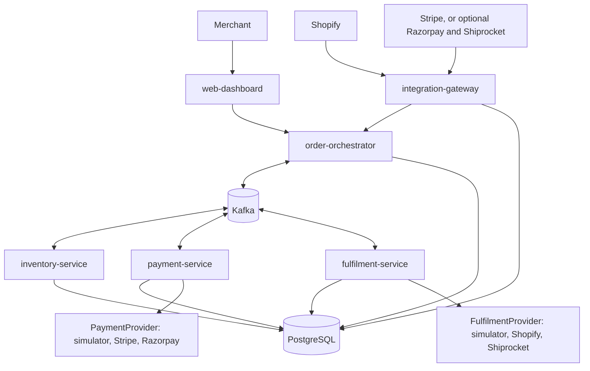

# Architecture

Five Spring Boot services and a React dashboard. PostgreSQL holds the truth and Kafka delivers messages. Payment and fulfilment providers sit behind ports whose default adapters are simulators (ADR 0007).



## Boundaries

- `integration-gateway` handles Shopify OAuth, verifies webhook signatures, stores raw events and publishes normalized events. It makes no business decisions.
- `order-orchestrator` owns saga state, deadlines, exceptions, findings and the dashboard API. It verifies Shopify session tokens for dashboard calls.
- `inventory-service`, `payment-service` and `fulfilment-service` react to commands, talk to their provider through a port, and reply. They never call each other. With no configuration, every port uses its simulator.
- Each service has its own PostgreSQL schema and connects with credentials that reach only that schema.
- All services use `platform-starter`, so tenancy and messaging exist in one implementation.

## Tenancy

The request flow:

1. Spring Security verifies the credential. In development this is an `X-Api-Key` header matched against `orderloop.security.dev-api-keys`. Keys work only with `orderloop.security.dev-api-keys-enabled=true`, and keys set without it stop startup; Shopify session tokens follow in M3.1. Every credential yields a `TenantPrincipal`.
2. `TenantBindingFilter` takes the tenant from the authenticated principal, and rejects a mismatched `X-Tenant-ID` with 403.
3. It binds the tenant with `ScopedValue` and copies it to MDC.
4. `TenantAwareDataSource` sets `app.tenant_id` on each connection at checkout.
5. PostgreSQL RLS applies to every statement, including native SQL and find-by-ID.

```java
public final class TenantContext {
  private static final ScopedValue<String> TENANT = ScopedValue.newInstance();

  private TenantContext() {}

  public static String require() {
    if (!TENANT.isBound()) {
      throw new IllegalStateException("No tenant bound to this scope");
    }
    return TENANT.get();
  }

  public static Optional<String> current() {
    return TENANT.isBound() ? Optional.of(TENANT.get()) : Optional.empty();
  }

  public static <R, X extends Throwable> R callAs(String tenantId, ScopedValue.CallableOp<R, X> op) throws X {
    if (tenantId == null || tenantId.isBlank()) {
      throw new IllegalArgumentException("tenantId is required");
    }
    if (TENANT.isBound() && !TENANT.get().equals(tenantId)) {
      throw new IllegalStateException("Cannot switch tenant inside another tenant's scope");
    }
    return ScopedValue.where(TENANT, tenantId).call(op);
  }
}
```

`callAs` infers `Exception` as the thrown type when a lambda throws two checked exceptions, so the filter narrows it again:

```java
try {
  TenantContext.callAs(tenantId, () -> { chain.doFilter(request, response); return null; });
} catch (IOException | ServletException | RuntimeException e) {
  throw e;
} catch (Exception e) {
  throw new ServletException(e);
}
```

`TenantAwareDataSource` wraps Hikari and runs this at every checkout, passing an empty string when no tenant is bound:

```sql
SELECT set_config('app.tenant_id', ?, false);
```

The setting is overwritten at every checkout, so a pooled connection cannot carry an old tenant into a new request. An empty value matches no rows, so missing context fails closed.

**Threads:** a scoped value does not cross into `@Async` or an ordinary executor. MDC and Spring's transaction state use `ThreadLocal` internally; that is acceptable, because neither is the source of tenant identity.

## Reliable messaging

- **Contracts:** `common-dto` holds `Money`, the sealed `SagaCommand` and `SagaEvent` records, `Envelope` and `Headers`, with no dependencies. `MessageTypes` names each type for the `x-event-type` header, and `common-dto/src/test/resources/golden/messages.txt` pins the JSON form of every message.
- **Outbox:** the domain change and its outbox row commit together: `OutboxWriter.append(topic, envelope)` refuses to run outside a transaction or for another tenant. `OutboxRelay` connects as `orderloop_ops` with its own small pool, producer (`acks=all`, idempotent, bounded timeouts) and polling thread, and runs when `orderloop.outbox.schema` is set. A row Kafka rejects waits, with its order's later rows, while other orders publish; it is logged by event ID. `orderloop_ops` ends a transaction left idle for a minute, so a frozen relay cannot hold the lock for hours. One relay per service publishes in ID order, per `.claude/rules/messaging.md`.
- **Topics:** `Topics` in `common-dto` names one commands topic and one events topic per downstream service, each with a `.dlt` topic. Every service with an outbox creates them all at startup (`OutboxAutoConfiguration`), because the broker never auto-creates topics and no service should depend on another starting first.
- **Ordering:** topics are keyed by `orderId`, and optimistic locking on the saga row serialises writes for one order.
- **Inbox:** `processed_event` is inserted in the same transaction as the handler's changes, so a redelivered event does nothing. `InboxConsumer` checks the headers, binds the tenant from `x-tenant-id`, and inserts with `ON CONFLICT DO NOTHING`; a failed handler rolls back its inbox row too, so a retry runs it again. After bounded retries a record goes to `<topic>.dlt` with its tenant header.
- **Redis:** caching and rate limits only. Losing Redis slows the system but cannot corrupt it.

## Provider side effects

The inbox cannot undo an HTTP call, so any provider write follows this pattern:

1. **Intent:** in a transaction, save an intent row with a stable idempotency key and status `INTENT`. Commit.
2. **Call:** outside any transaction, call the provider with the key.
3. **Result:** in a new transaction, save `SUCCEEDED` or `FAILED`, and write the reply to the outbox.
4. **Timeout or crash:** mark the intent `UNKNOWN`. A reconciler queries the provider and settles it. It never blindly retries a provider that lacks idempotency.

Razorpay refunds support this through the `X-Refund-Idempotency` header. Confirm equivalent support for each adapter and operation, including Stripe; where none exists, query before retrying. Simulators honour idempotency keys, so the pattern is tested without accounts.

## Observability

- JSON logs with `traceId`, `spanId`, `tenantId`, `orderId`
- W3C `traceparent` carried through Kafka headers
- Metrics: outbox backlog and age, consumer lag, saga state counts, missed deadlines, dead letters, provider latency and errors, late replies
- Alerts: outbox age over 5 minutes, any dead letter, reconciler backlog, failed backup

## Resource limits

Virtual threads make waiting cheap but do not add database capacity. Each service has a bounded Hikari pool (start at 10), semaphores around provider calls, and per-tenant limits.
