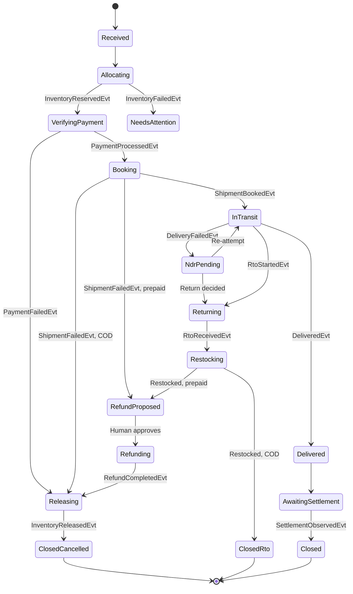

# Order saga

The orchestrator owns one saga per order. The saga starts after Shopify has accepted the order.

`NeedsAttention` can follow any state when a deadline passes. It keeps the prior state, so an operator or a late provider event can resume the saga.

After a refund, `Refunding` leads to `Releasing` when stock is still held, and to `ClosedRto` when the order came through a return. The application layer knows which from the saga's history.

## Steps

| State | Command | Replies | Default deadline | When the deadline passes |
|---|---|---|---|---|
| Allocating | `ReserveInventoryCmd` | `InventoryReservedEvt`, `InventoryFailedEvt` | 5 minutes | Exception |
| VerifyingPayment | `ProcessPaymentCmd` | `PaymentProcessedEvt`, `PaymentFailedEvt` | 15 minutes | Query provider, then exception |
| Booking | `BookShipmentCmd` | `ShipmentBookedEvt`, `ShipmentFailedEvt` | 2 hours | Exception, no automatic refund |
| Releasing | `ReleaseInventoryCmd` | `InventoryReleasedEvt`, `InventoryFailedEvt` | 15 minutes | Exception |
| InTransit | None; carrier events | `DeliveredEvt`, `DeliveryFailedEvt`, `RtoStartedEvt` | 10 days | Stuck-order finding |
| NdrPending | `ReattemptDeliveryCmd` when approved | Carrier events | 24 hours | NDR finding |
| Returning | None; carrier events | `RtoReceivedEvt` | 15 days | Stuck-order finding |
| Restocking | `RestockInventoryCmd` when approved | `InventoryRestockedEvt`, `InventoryFailedEvt` | 48 hours | RTO finding |
| RefundProposed | None; waits for a human | Approval | 24 hours | Paid-not-fulfilled finding |
| Refunding | `RefundPaymentCmd` | `RefundCompletedEvt`, `RefundFailedEvt` | 30 minutes | Reconciler, then exception |
| AwaitingSettlement | None; provider events | `SettlementObservedEvt` | 10 days | Remittance finding |

## Meaning of the commands

`ProcessPaymentCmd` verifies an existing payment. Shopify checkout has already charged or committed the customer, so a COD order replies `PaymentProcessedEvt` with `method=COD, captured=false`, and its money is tracked at settlement.

## Observe and action modes

Merchants usually already have Shopify and Shiprocket wired together. If OrderLoop booked shipments or moved stock by default, it would create duplicate shipments and wrong stock counts.

| Command | Observe mode (default) | Action mode |
|---|---|---|
| `ReserveInventoryCmd` | Confirm the order's stock state from Shopify | Allocate at a location |
| `ProcessPaymentCmd` | Verify capture or COD status | Same; it never charges |
| `BookShipmentCmd` | Wait for the shipment to appear | Book through the provider |
| `ReleaseInventoryCmd`, `RestockInventoryCmd` | Open a finding | Change stock after approval |
| `RefundPaymentCmd` | Blocked at the adapter | Refund after human approval |

Observe mode needs less customer data, because the address is not needed to book anything. Automated tests and the portfolio demo use action mode against simulators.

## Rules

- Provider events can arrive early. A carrier event that proves later progress moves the saga forward, and the skipped step is recorded as observed.
- A late or duplicate reply is ignored and counted.
- A compensation undoes only completed steps, in reverse order.
- A failed compensation opens an exception; it never loops forever.
- Refund amounts come from the provider's record of what was captured, minus any earlier refund.
