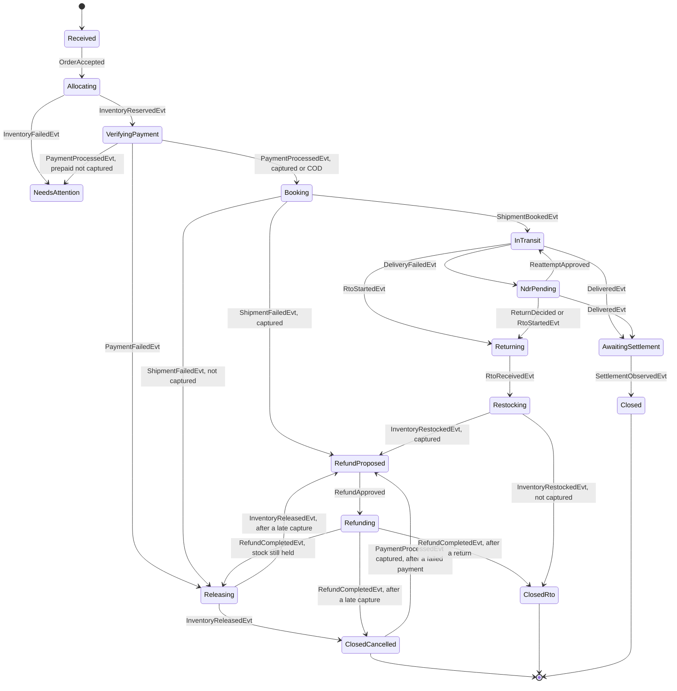

# Order saga

The orchestrator owns one saga per order. The saga starts after Shopify has accepted the order.

`NeedsAttention` can follow any state when a deadline passes. It keeps the prior state, so an operator or a late provider event can resume the saga. Early carrier and settlement events (below) are left out of the diagram.

After a refund, `Refunding` leads to `Releasing` when stock is still held, to `ClosedRto` when the order came through a return, and to `ClosedCancelled` after a late capture. `RefundProposed` and `Refunding` carry which one it is.

## Engine

`SagaEngine.decide(SagaState state, SagaInput input, Instant now)` in `order-orchestrator` is a pure function: no I/O, no clock, no Spring. It returns a `Transition`: the next state, commands to emit, the deadline now in force, a finding to open, and whether the input was ignored.

- **Inputs:** `Reply(SagaEvent)` wraps every Kafka reply and provider event. The others are internal and never go on the wire: `OrderAccepted` (starts the saga from `Received`), `RefundApproved`, `ReattemptApproved`, `ReturnDecided`, `RestockApproved`, `RetryStep` (a human acted), and `DeadlinePassed(kind)`.
- **Deadlines:** each state with work outstanding has exactly one deadline, derived from the state entered, so a transition cannot forget it. Re-entering a state restarts it. A transition that only records a fact on the current step, such as an early settlement, keeps the deadline in force instead: `keepsDeadline()` is true, as it is for an ignored transition. A `DeadlinePassed` of another kind is stale and ignored. The engine cannot tell an older deadline of the same kind from the current one, so the deadline scanner checks `dueAt` against the stored deadline before calling it. An ignored transition changes no deadline, and reading its deadline throws.
- **Refunds:** only `RefundApproved` on `RefundProposed`, or an operator's `RetryStep` on a failed `Refunding`, sends `RefundPaymentCmd`. Both are human actions (invariant 8). The refund is the captured amount, in its currency, with `refundId` `rf-<orderId>`, so a repeated command is the same refund. The payment service still caps it at captured minus earlier refunds.
- **Captured or not:** a prepaid payment reported as not captured never ships; the saga needs attention. After a failed booking or a restock, the saga proposes a refund when the payment was captured, and releases stock or closes when it was not (COD).
- **Late capture:** if a payment is reported captured after `PaymentFailedEvt`, the saga never cancels silently. While stock is being released it remembers the capture and proposes a refund once the release completes. After `ClosedCancelled` it reopens with a refund proposal and a paid-not-fulfilled finding. On other paths a payment reply is a duplicate and is ignored.
- **`NeedsAttention`:** entered on a failure the saga cannot compensate, or when a deadline passes. An exception is open while the saga is here, so it has no deadline of its own. `RetryStep` re-runs the step it stopped at, sending its command again, or restarts the wait for steps that wait on the world or on an approval. Any other input except a deadline is decided against the prior state; if that would move the saga on, it does and the exception closes. A reply that would only park it again, such as a duplicate failure, is ignored.
- **Findings:** every missed deadline opens a finding. It is a stuck-order finding unless a more specific detector applies: NDR past SLA, RTO not restocked, paid-not-fulfilled (an unapproved refund, or a captured order not shipped), and the COD remittance gap (COD only).
- **`Delivered`** is passed through at once: `DeliveredEvt` moves the saga to `AwaitingSettlement`.
- **`VerifyingPayment`:** when its deadline first passes, the saga sends `ProcessPaymentCmd` again (it only verifies), with a fresh deadline. The second time, it needs attention.
- **Approvals:** `RestockApproved` sends `RestockInventoryCmd` once; a second approval is ignored. A restock the merchant made by hand (`InventoryRestockedEvt` with no approval) is accepted.
- **Early carrier events:** in `Booking`, `DeliveredEvt`, `DeliveryFailedEvt`, `RtoStartedEvt` and `RtoReceivedEvt` move the saga straight to where the event proves it is. So does `RtoReceivedEvt` in `InTransit` and `NdrPending`. The transition is marked early, so the skipped steps are logged as observed.
- **Early settlement:** money can reach the merchant before the carrier reports delivery, typically a prepaid payout; the engine treats any payment method the same. `SettlementObservedEvt` in `Booking`, `InTransit` or `NdrPending` is remembered on the payment (`settled`), and the step's deadline keeps running. `DeliveredEvt` then closes the order at once, marked early because `AwaitingSettlement` was skipped. A second settlement is a duplicate. While parked in `NeedsAttention`, the settlement is remembered on the prior state and the exception stays open. From `Returning` on it is ignored: a return ends in a refund proposal or `ClosedRto` whether or not the money settled.

## Applying a transition

`SagaService` in `order-orchestrator` reads the saga row, calls `decide`, and applies the result in one transaction:

- An ignored transition writes nothing and increments the `orderloop.saga.ignored` metric.
- Otherwise it updates the row with `version = version + 1 WHERE version = <version read>`, writes the `saga_step_log` row with `seq` equal to the new version, and appends each command to the outbox on its topic from `Topics.of`. The `cause_event_id` and the outbox rows' `x-causation-id` are the reply's event ID.
- If another transaction moved the saga after it was read, the update matches no row and the whole transaction rolls back, inbox row included. The listener's error handler retries it, so the reply is decided again against the state that won. Two replies for one order therefore never both act on the same state.
- A transition that keeps the deadline (`Transition.stay`) is applied like any other: the row's version moves on and the step log records a step from a state to itself, such as `InTransit->InTransit`. From `NeedsAttention` to `NeedsAttention` it neither opens nor resolves an exception.
- Creating an order inserts `Received` and applies `OrderAccepted`. A repeat finds the row and emits nothing.
- Entering `NeedsAttention` opens an `exception_case` for the order value, with the attention reason. Leaving it resolves the case, recording the input that resumed the saga. At most one case is open per order. Opening a second, or leaving with no open case to resolve, means the two have drifted apart: the transition fails and rolls back, so the saga stays where it was and the reply is retried, then dead-lettered.
- The deadline in force is stored in `saga_deadline`, one row per saga, in the same transaction: replaced when the transition enters a step with a deadline, removed when it enters one without (`NeedsAttention`, or a closed state), and left as it is when the transition keeps the deadline.
- A finding is stored in `leak_finding`, one row per detector and order; finding the same leak again reopens it. The amount follows `docs/PRODUCT.md`: what was paid for paid-not-fulfilled and the COD remittance gap, otherwise the order value, which is labelled an estimate for RTO not restocked.

## Firing deadlines

`DeadlineScanner` in `order-orchestrator` polls every `orderloop.orchestrator.deadline-poll-interval` (5 seconds by default). It reads due deadlines across tenants as `orderloop_ops`, which may only read them, and fires each one as `orderloop_app` in its tenant's scope through `SagaService.fireDeadline`. That locks the stored deadline and fires it only if its kind and `dueAt` still match the scan, so a deadline replaced since the scan, or already fired by another orchestrator, does nothing. Firing applies `DeadlinePassed` like any other input, so the step table above decides what happens: usually the saga parks in `NeedsAttention` with an exception and a finding, and the deadline is removed, but a first `VerifyingPayment` deadline asks again and stores a fresh one. It locks the saga row before the deadline, the order a reply takes them in, so a reply and a firing at the same moment queue up rather than deadlock. A stored deadline the engine ignores disagrees with the saga's state; it is dropped and logged rather than fired every poll. Deadlines live in the database, so one stored before a restart fires after it.

## Steps

| State | Command | Replies | Default deadline | When the deadline passes |
|---|---|---|---|---|
| Received | None; `OrderAccepted` starts the saga | None | None, left at once | Not applicable |
| Allocating | `ReserveInventoryCmd` | `InventoryReservedEvt`, `InventoryFailedEvt` | 5 minutes | Exception, stuck-order finding |
| VerifyingPayment | `ProcessPaymentCmd` | `PaymentProcessedEvt`, `PaymentFailedEvt` | 15 minutes | Ask again; the second time, exception and stuck-order finding |
| Booking | `BookShipmentCmd` | `ShipmentBookedEvt`, `ShipmentFailedEvt` | 2 hours | Exception, no automatic refund; paid-not-fulfilled finding if captured, otherwise stuck-order |
| Releasing | `ReleaseInventoryCmd` | `InventoryReleasedEvt`, `InventoryFailedEvt` | 15 minutes | Exception, stuck-order finding |
| InTransit | None; carrier events | `DeliveredEvt`, `DeliveryFailedEvt`, `RtoStartedEvt`; an early `SettlementObservedEvt` is remembered | 10 days | Exception, stuck-order finding |
| NdrPending | `ReattemptDeliveryCmd` when approved | Carrier events | 24 hours | Exception, NDR finding |
| Returning | None; carrier events | `RtoReceivedEvt` | 15 days | Exception, stuck-order finding |
| Restocking | `RestockInventoryCmd` when approved | `InventoryRestockedEvt`, `InventoryFailedEvt` | 48 hours | Exception, RTO finding |
| RefundProposed | None; waits for a human | `RefundApproved` | 24 hours | Exception, paid-not-fulfilled finding |
| Refunding | `RefundPaymentCmd` | `RefundCompletedEvt`, `RefundFailedEvt` | 30 minutes | Exception, stuck-order finding; the payment service's reconciler settles the refund |
| AwaitingSettlement | None; provider events | `SettlementObservedEvt` | 10 days | Exception; remittance finding for COD, otherwise stuck-order |
| NeedsAttention | None; an exception is open | `RetryStep`, or any input resuming the prior state | None | Not applicable |

`InventoryFailedEvt` while releasing or restocking, and `RefundFailedEvt`, also lead to `NeedsAttention`; a compensation is never retried in a loop, only by an operator's `RetryStep`.

## Meaning of the commands

`ProcessPaymentCmd` verifies an existing payment. Shopify checkout has already charged or committed the customer, so a COD order replies `PaymentProcessedEvt` with `method=COD, captured=false`, and its money is tracked at settlement.

## Observe and action modes

Merchants usually already have Shopify and a shipping provider wired together. If OrderLoop booked shipments or moved stock by default, it would create duplicate shipments and wrong stock counts.

| Command | Observe mode (default) | Action mode |
|---|---|---|
| `ReserveInventoryCmd` | Confirm the order's stock state from Shopify | Allocate at a location |
| `ProcessPaymentCmd` | Verify capture or COD status | Same; it never charges |
| `BookShipmentCmd` | Wait for the shipment to appear | Book through the provider |
| `ReleaseInventoryCmd`, `RestockInventoryCmd` | Open a finding | Change stock after approval |
| `RefundPaymentCmd` | Blocked at the adapter | Refund after human approval |

Observe mode needs less customer data, because the address is not needed to book anything. Automated tests and the Docker demo use action mode against simulators.

## Rules

- Provider events can arrive early. A carrier event that proves later progress moves the saga forward, and the skipped step is recorded as observed.
- A late or duplicate reply is ignored and counted.
- A compensation undoes only completed steps, in reverse order.
- A failed compensation opens an exception; it never loops forever.
- Refund amounts come from the provider's record of what was captured, minus any earlier refund, in the captured currency.

## Known gaps

- `DeliveryFailedEvt` carries only `orderId` and a `reason` code, with no attempt number. The inbox absorbs a redelivery of the same event, but a carrier webhook resent under a new event ID after a re-attempt moves the saga back to `NdrPending`. Telling an old NDR from a new one needs an attempt number on the event. That contract change is left to the first real carrier adapter (M2.7 or M2.10), because the simulator reports each failure once.
- A settlement before `Booking`, in `VerifyingPayment` or while parked there, is still ignored, so that order later waits in `AwaitingSettlement` and opens a false stuck-order finding. Verification normally ends within minutes, long before a payout.
- The settled amount and currency are not compared with the payment. Payouts arrive net of fees, so an exact match would raise false alarms; a partial or wrong-currency settlement still closes the order. Spotting a settlement gap belongs to a detector (M3).
- A prepaid RTO whose restock cannot succeed has no refund until an operator retries or resolves it. Whether to propose the refund on `RtoReceivedEvt`, before the restock, is a product decision.
